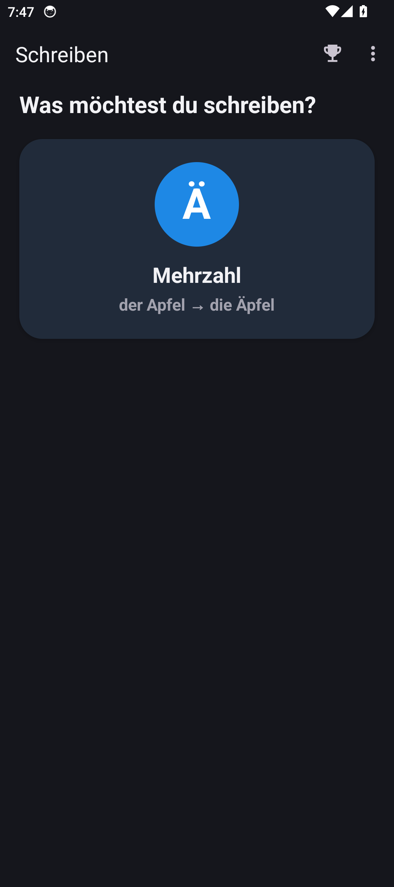
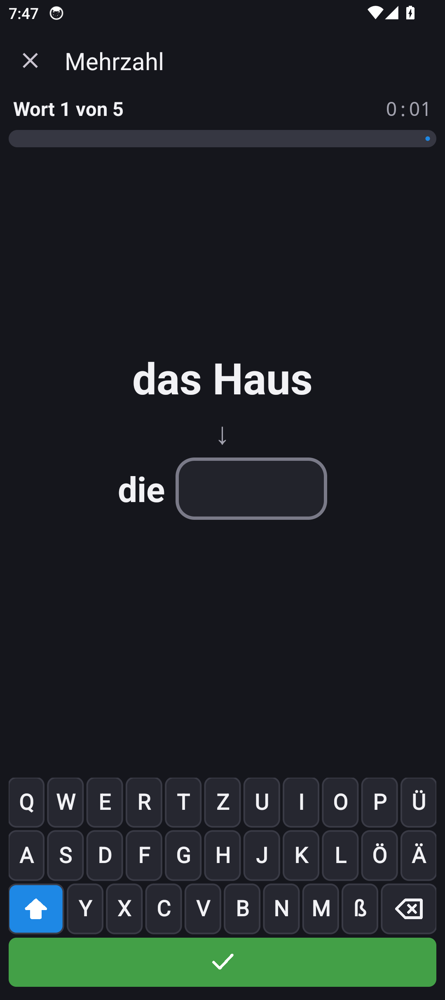
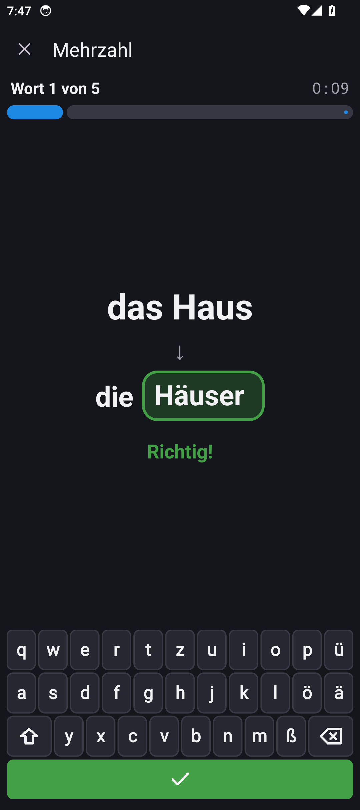
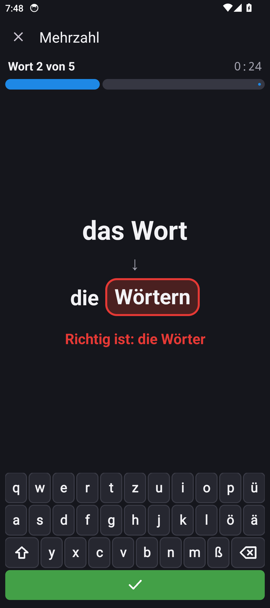
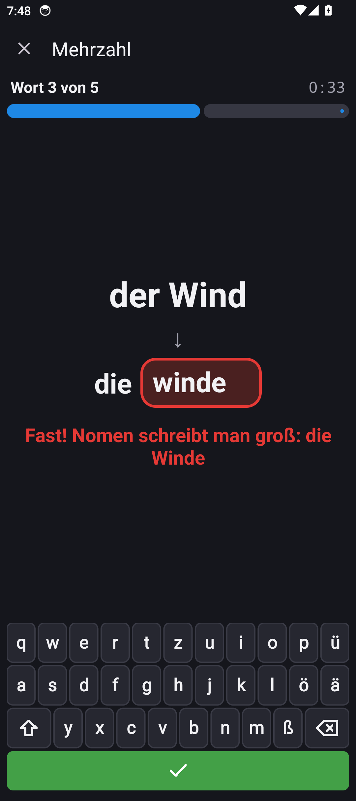
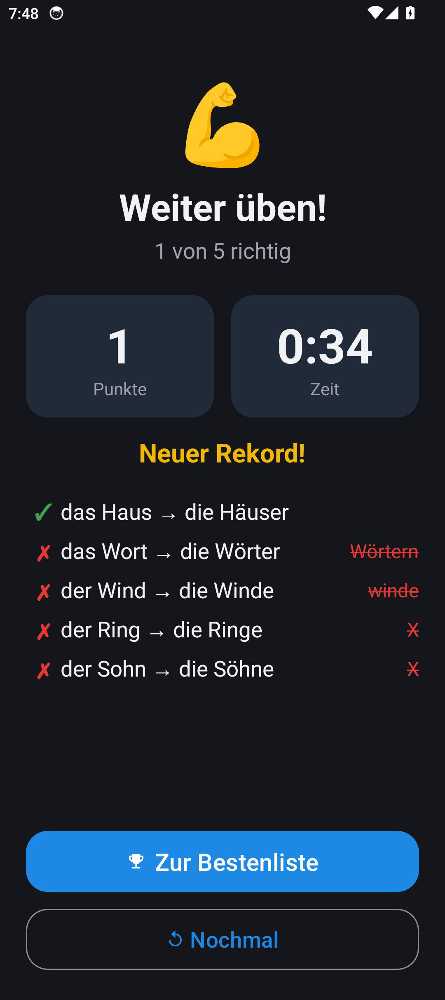
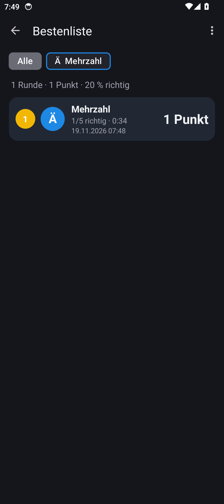

# Rechtschreiben als App

**Schreiben** ist eine kleine Android-App, mit der Grundschulkinder Rechtschreibung üben. Entstanden
ist sie für den Hausgebrauch, auf dem Handy und auf dem Kinder-Tablet. Kurze Runden mit fünf
Wörtern, eine große Bildschirmtastatur mit Umlauten und eine Bestenliste machen daraus ein kleines
Spiel.

## So funktioniert's

Das Kind wählt ein **Spiel**; eine Runde hat **fünf Wörter**, die Zeit läuft mit. Das Wort wird
über die große Tastatur mit Ä, Ö, Ü und ß eingetippt und mit ✓ abgeschickt; gleich danach zeigt die
App, ob es stimmt, und bei einem Fehler die richtige Schreibweise. Für jedes richtige Wort gibt es
einen Punkt.

Das erste Spiel ist **Mehrzahl**: Gezeigt wird ein Nomen mit Artikel, etwa *der Apfel*, und das
Kind schreibt *die Äpfel*. Jede Runde enthält mindestens zwei Wörter, deren Mehrzahl einen Umlaut
bekommt, denn gerade die sind knifflig. Die Wörter stammen aus dem Grundwortschatz der ersten und
zweiten Klasse (LehrplanPLUS Bayern), ergänzt um häufige Wörter wie Hand – Hände oder Kuh – Kühe.

<table>
<tr>
<td width="50%"></td>
<td width="50%"></td>
</tr>
<tr>
<td><b>Start:</b> eine Kachel je Spiel, darunter ein Beispiel.</td>
<td><b>Schreiben:</b> großes Wort, große Tastatur mit Umlauten, oben Fortschritt und Zeit.</td>
</tr>
<tr>
<td width="50%"></td>
<td width="50%"></td>
</tr>
<tr>
<td><b>Richtig:</b> Das Wort wird grün.</td>
<td><b>Fehler:</b> Die App zeigt gleich die richtige Schreibweise.</td>
</tr>
<tr>
<td width="50%"></td>
<td width="50%"></td>
</tr>
<tr>
<td><b>Fast:</b> Bei vergessener Großschreibung gibt es einen eigenen Hinweis.</td>
<td><b>Ergebnis:</b> Punkte, Zeit und alle fünf Wörter, falsche mit der eigenen Antwort daneben.</td>
</tr>
<tr>
<td width="50%"></td>
<td width="50%"></td>
</tr>
<tr>
<td><b>Bestenliste:</b> alle Runden nach Punkten, filterbar nach Spiel.</td>
<td></td>
</tr>
</table>

## Kleine Details

- **Keine Autokorrektur:** Die App bringt ihre eigene Tastatur mit, damit keine Wortvorschläge die
  Lösung verraten.
- **Großschreibung zählt:** Am Wortanfang ist die Umschalttaste schon gedrückt; wer sie bewusst
  ausschaltet und klein schreibt, bekommt keinen Punkt, aber einen freundlichen Hinweis.
- **Gezählt wird nur die Denkzeit:** Die Uhr läuft nur, solange ein Wort auf die Antwort wartet.
- **Abbrechen zählt nicht:** Eine angefangene Runde verschwindet einfach, die Bestenliste bleibt
  ehrlich.
- **Hell oder dunkel:** Standardmäßig dunkel, im Menü auf hell umschaltbar.
- **Bestenliste mitnehmen:** Sie lässt sich als Datei exportieren und auf einem neuen Gerät wieder
  importieren.

## Ausprobieren

Auf einem Android-Gerät (ab Version 8) die APK-Datei vom
[neuesten Release](https://github.com/hansmaulwurf23/schreiben/releases/latest) herunterladen
und öffnen. Android fragt einmal, ob Apps aus dieser Quelle installiert werden dürfen, und warnt
eventuell, weil die App nicht aus dem Play Store kommt; beides lässt sich bestätigen. Auf einem
Amazon-Fire-Kids-Tablet im Eltern-Profil installieren und die App dann für das Kinderprofil
freigeben. Für iPhones gibt es die App nicht.

## Gut zu wissen

Die App ist kostenlos, hat keine Werbung und braucht kein Konto. Gespeichert wird nur auf dem Gerät
selbst; ins Internet geht sie lediglich, um nach einer neuen Version zu suchen. Sie läuft auf Android
ab Version 8 und ist nicht im Play Store. Der Code steht unter der [MIT-Lizenz](../LICENSE).
